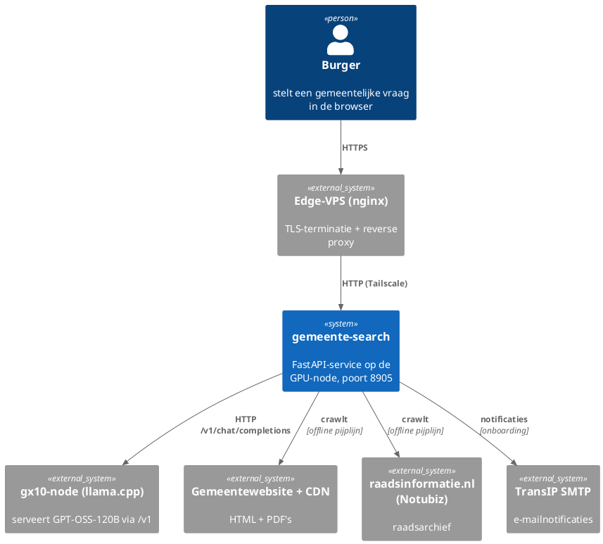

# Contextdiagram

## Uitleg

- **Burger → Edge-VPS → service**: publiek verkeer eindigt op TLS op de VPS;
  de VPS proxyt over Tailscale naar de service op de GPU-node (poort 8905).
- **Service → gx10-node**: alleen tijdens het beantwoorden; de LLM draait
  lokaal op `100.64.x.x:8083`, geen externe API.
- **Crawl-relaties zijn offline**: de crawler draait als aparte
  pipeline-stappen, niet als onderdeel van het request/response-pad.

Zie [external-systems.md](external-systems.md) voor details per systeem en
[data-flow-overview.md](data-flow-overview.md) voor de stromen.
