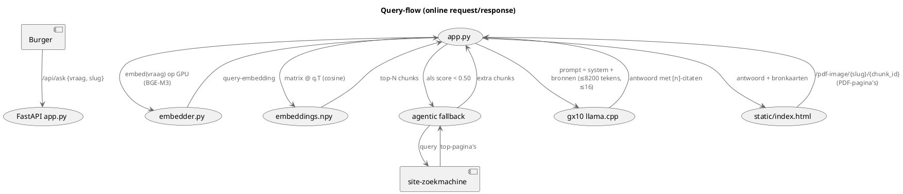

# Query-flow (online)

De route van "vraag" naar "geciteerd antwoord" binnen één request.

## Stappen

1. **Vraag + slug** binnen via `/api/ask` (of `/api/search` voor directe
   chunk-hits).
2. **Embed** de vraag op de GPU met BGE-M3.
3. **Score** alle chunks van de gemeente via één matrixproduct
   (`embeddings.npy @ q.T`) en neem de top-N.
4. **Drempel**: is de beste score < 0.50, dan **agentic fallback** — site-zoek,
   top-pagina's ophalen, chunks injecteren (ADR-005).
5. **Prompt bouwen**: system-prompt (Nederlands, citatieregels) + vraag +
   geselecteerde bronnen binnen budget (≤ ~8200 tekens, ≤ 16 bronnen).
6. **Genereren**: LLM-call naar de gx10 met
   `chat_template_kwargs: {enable_thinking: false}`, `max_tokens=1800`,
   `temperature=0.2`.
7. **Renderen**: antwoord met `[n]`-citaten; de UI toont bronkaarten,
   markeert geciteerde bronnen, en laadt voor PDF-bronnen de pagina-afbeelding
   via `/pdf-image/{slug}/{chunk_id}`.

## Twee endpoints

- `/api/ask` — volledige RAG: retrieval + LLM + citaten.
- `/api/search` — alleen retrieval (top chunks), voor de "Zoeken"-tab.
